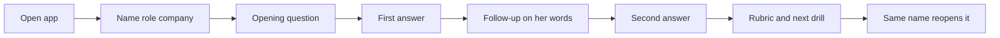

# MVP user flow — Meera Shah

Date: 10 October 2026
Status: Storyboard for the one-hour MVP
Related: [prd-and-technical-design.md](prd-and-technical-design.md)

This is one person's first session. SDE and product manager use the same screens. Only the question and the rubric names change.

## 1. Persona

| | |
| --- | --- |
| Name | Meera Shah |
| Situation | Final-year B.Com, Bengaluru |
| Goal | Financial analyst interview at a bank, in four days |
| When she opens the app | 11:30 pm, alone. No senior is awake. |
| What she uses today | Class notes, and a generic chatbot |
| What those miss | Neither points at the sentence in her own answer that was weak |
| Success for her | She can say which line was thin, and she leaves with one drill she would actually do |

She is the persona because the research notes name commerce students as the gap, and the finance question is concrete enough to walk through: revenue 100, cost of goods 60, operating expenses 30.

## 2. Happy path

Worked example. The bank name she types is Horizon Bank, a stand-in for the campus recruiter.

1. She types **Meera Shah**, picks **Finance**, and types **Horizon Bank**.
2. Coach asks: revenue 100, cost of goods 60, operating expenses 30. What is the operating margin, and what does it tell you?
3. She answers: "Operating margin is 10%. The business keeps ten rupees of every hundred after running costs."
4. Follow-up uses her words: "You said it keeps ten rupees of every hundred. If operating expenses rose to 40, what would you tell the manager?"
5. She answers: "The margin falls to zero. I would tell the manager the extra ten went into operating expenses, so that is the line to inspect."
6. She ends the session. The rubric scores calculation, concept, interpretation, and structure. Each row quotes her, says what is missing, and offers one stronger beat. One next drill sits under the rows.
7. She closes the tab. The next day she types the same name and opens the saved result. This MVP does not start a second interview.

Operating margin in the question is (100 − 60 − 30) / 100 = 10%. If expenses rise to 40, it is (100 − 60 − 40) / 100 = 0%.

## 3. Step by step

### Open

| | |
| --- | --- |
| She sees | An empty setup: name, three roles, optional company |
| She does | Nothing yet |
| API | `GET /roles` returns SDE, Product, Finance |

### Setup

| | |
| --- | --- |
| She sees | Finance highlighted. Name and company filled. |
| She does | Submits the form |
| API | `POST /sessions` with `{ "display_name": "Meera Shah", "role_id": "finance", "company": "Horizon Bank" }`. The row is created. The opening interviewer message is stored. Status is `active`. |

### Opening question

| | |
| --- | --- |
| She sees | The finance question in the transcript. An empty answer box. |
| She does | Reads it |
| API | No new call. The question came back with the session. |

### First answer

| | |
| --- | --- |
| She sees | Her text in the box, then in the transcript |
| She does | Sends the 10% answer |
| API | `POST /sessions/{id}/turns` with `{ "answer": "..." }`. Her message is stored. The model writes one follow-up that refers to her interpretation. That follow-up is stored and returned. |

### Follow-up

| | |
| --- | --- |
| She sees | A second coach bubble that uses her phrase about ten rupees |
| She does | Reads it |
| API | No new call |

### Second answer

| | |
| --- | --- |
| She sees | Her second reply in the transcript, then an end control |
| She does | Sends the expenses-rose answer |
| API | `POST /sessions/{id}/turns` again. This call stores her answer and does not ask another question. A third follow-up is rejected. |

### Rubric

| | |
| --- | --- |
| She sees | Four rows, then one drill |
| She does | Ends the session and reads the rows |
| API | `POST /sessions/{id}/finish`. The model returns rubric JSON. It is stored on `evaluations`. Session status becomes `finished`. |

Illustrative rubric for this storyboard. Real scores come from the model. Quotes must be spans from the transcript.

| Dimension | Score | Quote | Missing | Stronger beat |
| --- | --- | --- | --- | --- |
| Calculation | 4/4 | "Operating margin is 10%." | Nothing on the arithmetic | Keep the formula visible: (100 − 60 − 30) / 100 |
| Concept | 3/4 | "after running costs" | Does not name operating expenses versus cost of goods | Say which line is operating expense |
| Interpretation | 2/4 | "keeps ten rupees of every hundred" | The first answer stops at the definition | Tell the manager what changes if that number moves |
| Structure | 3/4 | The second answer names the line to inspect | The recommendation arrives only after the probe | Lead with the number, then the action |

Next drill: recalculate the margin if operating expenses are 40, and write the one sentence you would say to the manager.

The summary states proficiency on this rubric. It does not say she will or will not get the offer.

### Next day

| | |
| --- | --- |
| She sees | A list with last night's finance session, the summary, and the drill |
| She does | Types **Meera Shah** and opens that session |
| API | `GET /sessions?name=Meera%20Shah` returns her sessions, newest first. `GET /sessions/{id}` returns the transcript and the evaluation. |

She cannot start a new interview from this screen in the MVP. The saved result is the memory.

## 4. Unhappy path — coach not configured

`GEMINI_API_KEY` is missing when she sends her first answer.

| | |
| --- | --- |
| She sees | A clear line: the coach is not configured. No score. |
| She does | Stays on the question. Her draft answer remains in the box. |
| API | The turn call returns an error. The session stays `active`. No evaluation row is written. No invented quote. |

The same error applies if she reaches finish without a key. The session stays unfinished.

## 5. Not in this session

- Login, accounts, payments
- Voice or a timer
- A spreadsheet or calculator
- A second interview question
- A prediction that she will be hired
- A new session the next day

SDE and product manager reach the same setup, transcript, rubric, and saved-session screens. Their opening questions and rubric names are the ones in the technical design.
